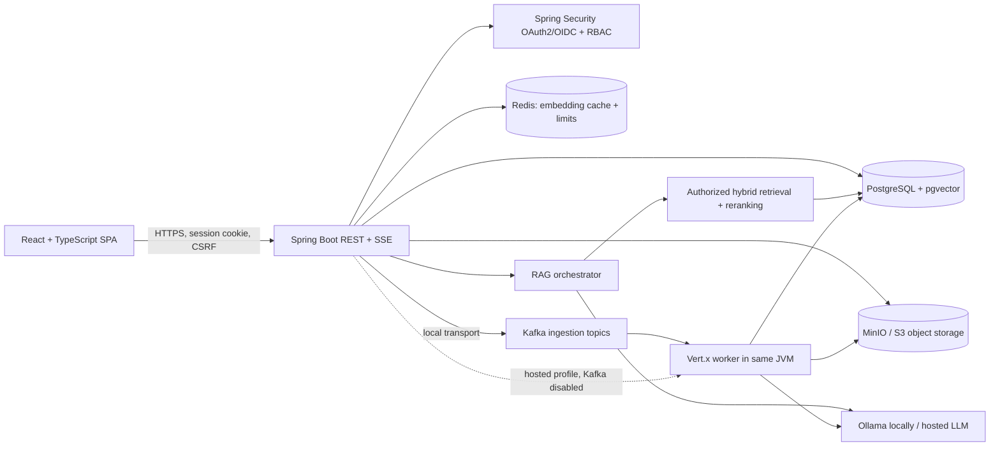
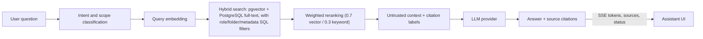

# Edify

## Enterprise AI Knowledge Platform

Edify is a role-aware knowledge workspace for uploading company documents and asking
grounded questions with source citations. The application pairs a React and TypeScript
workspace with a stateful Spring Boot API, authorization-aware hybrid search, and an
asynchronous ingestion pipeline.

The design stays intentionally small: Spring Boot owns HTTP and security; Vert.x processes
ingestion inside the same JVM; Kafka carries local ingestion events; PostgreSQL/pgvector
stores application data and embeddings. Cloud deployments can use hosted AI and dispatch
ingestion to the embedded worker without operating Kafka.

**Local image note:** the Compose MinIO service uses the pinned
`bitnamilegacy/minio:2025.7.23-debian-12-r5` image because the previously configured
`minio/minio` Docker Hub tag is no longer publicly available. The legacy image is for
local development only; use managed S3-compatible object storage for deployments.

## Table of contents

- [Features](#features)
- [Screenshots](#screenshots)
- [Architecture](#architecture)
- [Technology stack](#technology-stack)
- [RAG pipeline](#rag-pipeline)
- [Event-driven ingestion](#event-driven-ingestion)
- [Security](#security)
- [Roles and permissions](#roles-and-permissions)
- [Project layout](#project-layout)
- [Docker](#docker)
- [Local development](#local-development)
- [Google OAuth setup](#google-oauth-setup)
- [Configuration reference](#configuration-reference)
- [API documentation](#api-documentation)
- [Testing](#testing)
- [Cloud deployment](#cloud-deployment)
- [Health and metrics](#health-and-metrics)
- [CI/CD](#cicd)
- [Resume description](#resume-description)
- [Known limitations and future improvements](#known-limitations-and-future-improvements)

## Features

- **Stateful session auth** with Google OAuth2/OIDC login (`JSESSIONID` cookie, CSRF
  enabled) — no JWTs, no stateless API tokens.
- **Four roles**, enforced both at the HTTP route layer and in SQL: `READ < WRITE <
  CUSTODIAN < ADMIN`. A configured bootstrap admin email is provisioned as `ADMIN` on
  first login; everyone else starts as `READ` until promoted.
- **Drive-style document organization** — nested folders, breadcrumbs, per-folder
  minimum-role gating, move documents/folders between locations.
- **Versioned document storage** — PDF, TXT, Markdown, and DOCX originals live in MinIO;
  PostgreSQL stores version metadata, SHA-256 hashes, active-version pointers, and indexed
  chunks. Duplicate uploads in the same user's folder are skipped.
- **Consistent resource authorization** — `AuthorizationService` applies document and
  ancestor-folder permissions to browsing, retrieval, and document/folder writes; vector
  search excludes inaccessible folders before chunks can enter RAG context.
- **Traceable API failures** — consistent JSON error responses and validated
  `X-Correlation-ID` values propagated into Vert.x ingestion work and log MDC.
- **Vert.x-powered ingestion pipeline** — chunking, embedding (Ollama `qwen3-embedding`),
  and pgvector persistence run off the main HTTP thread via Kafka and a Vert.x worker;
  document processing jobs persist stage, completion, and failure state.
- **Role-filtered RAG search** — queries are classified for in-scope/out-of-scope intent,
  matched against role- and folder-aware pgvector and PostgreSQL full-text results, then
  reranked with 0.7 vector / 0.3 keyword score weights. Optional department, document
  type, tags, and owner filters apply before retrieval. Answers include source citations,
  and retrieved excerpts are treated as untrusted evidence by the LLM.
- **Swappable AI providers** — `EmbeddingProvider` and `LlmProvider` select Ollama locally
  or OpenAI-compatible cloud endpoints through `AI_PROVIDER`; the configured embedding
  model must return 1024 dimensions to match the pgvector column.
- **Persisted AI conversations** — per-user conversation/message history, short recent
  context for follow-up questions, progressively rendered Markdown answers and source
  cards, retry for interrupted responses, and token/source/status/completion/error SSE events.
- **Selective Redis use** — embeddings are cached by content SHA-256 and model ID, while
  atomic per-user minute limits protect document uploads and conversation messages.
- **Application observability** — Spring Boot Actuator provides safe health/probe endpoints
  and admin-only metrics; Micrometer records RAG, retrieval, embedding, LLM, ingestion, and
  Kafka publish failure measurements.
- **Integration coverage** — Testcontainers exercises pgvector, Redis, and Kafka together;
  focused unit tests cover authorization, ingestion failures, conversation retry rules,
  reranking, and RAG citation/prompt behavior.
- **Responsive workspace UI** — dashboard overview, searchable/sortable knowledge explorer,
  drag-and-drop supported-file uploads with ingestion-stage progress for uploads and text
  changes, version history, collapsible navigation, and light/dark/system appearance settings.
- **Local Compose infrastructure** for PostgreSQL/pgvector, Redis, MinIO, and single-node
  Kafka, plus a GitHub Actions pipeline that builds/tests/packages on every push.

## Screenshots

Representative UI captures currently checked into the repository:

| AI assistant with citations | Knowledge explorer |
|---|---|
|  |  |

| Role and access management |
|---|
|  |

## Architecture

See [`ARCHITECTURE.md`](ARCHITECTURE.md) for the full write-up. Short version:



## Technology stack

| Area | Technologies |
|---|---|
| Backend | Java 17, Spring Boot, Spring Security, OAuth2/OIDC, Spring MVC, Vert.x |
| Data and infrastructure | PostgreSQL, pgvector, Redis, Kafka, MinIO/S3 |
| AI | Ollama or OpenAI-compatible cloud providers, hybrid RAG, SSE |
| Frontend | React, TypeScript, Vite, Tailwind CSS, Lucide |
| Delivery | Docker Compose, GitHub Actions, GHCR, Vercel/Render deployment configuration |
| Quality | JUnit, Spring Boot Test, Testcontainers, Actuator, Micrometer |

## RAG pipeline



Retrieval applies role/folder authorization and optional department, document-type, tag,
and owner filters inside the SQL searches, before retrieved text can reach the LLM. Source
locations are not currently extracted, so page and section citations may be empty.

## Event-driven ingestion

For local development, document metadata, version records, and the original object are
saved before an `edify.document.uploaded` Kafka event is published. A Kafka listener
dispatches work to a Vert.x verticle; `executeBlocking` runs parsing, chunking, embedding,
and indexing away from the Vert.x event loop. Ingestion stage, completion, and failure
are persisted as job state. In the hosted profile, Kafka may be disabled and dispatch
goes directly to the same worker; this fallback does not provide durable replay.

## Security

Google OAuth2/OIDC establishes a stateful HTTP session. Spring Security retains CSRF
protection, and role checks are combined with document and ancestor-folder authorization.
The same access constraints apply during browsing, download, and RAG retrieval. New users
start with `READ`; role elevation follows the documented custodian/admin rules.

This repository currently uses a single shared knowledge corpus and is **not tenant
isolated**. Do not operate it as a multi-tenant service without adding tenant-scoped
identity, storage, database constraints, and retrieval filters.

## Roles and permissions

| Role | Can read search results & browse documents | Can upload / update / delete documents & folders | Can grant `WRITE` | Can grant `CUSTODIAN`/`ADMIN` |
|---|:---:|:---:|:---:|:---:|
| `READ` | ✅ | ❌ | ❌ | ❌ |
| `WRITE` | ✅ | ✅ | ❌ | ❌ |
| `CUSTODIAN` | ✅ | ✅ | ✅ | ❌ |
| `ADMIN` | ✅ | ✅ | ✅ | ✅ |

- The configured system admin (`app.security.admin-email`) is seeded in the DB and
  re-asserted as `ADMIN` + `systemAdmin=true` on every login — it cannot be demoted
  through the API.
- Every other new Google sign-in starts at `READ`. An `ADMIN` or `CUSTODIAN` must
  promote them via `PUT /api/admin/users/{id}/role`.

## Project layout

```
src/main/java/com/example/ragingestor/
  config/       Security, CORS, OpenAPI, Vert.x, and SSE configuration
  domain/       JPA entities and PostgreSQL/pgvector repositories
  ingestion/    Document lifecycle, object storage, Kafka and Vert.x processing
  observability/ Micrometer timers and counters
  rag/          Retrieval, reranking, provider abstractions, conversations, SSE
  security/     OAuth2/OIDC principals, authorization, roles, API error handling

Frontend/       React + TypeScript + Vite workspace
docker-compose.yml        Full local stack (frontend, backend, Postgres, Redis, Kafka,
                          MinIO, Ollama)
docker-compose.dev.yml    Native hot-reload development infrastructure
Dockerfile                Bundled frontend/backend image
Dockerfile.backend        Backend-only image
Frontend/Dockerfile       Nginx-served SPA image
.github/workflows/        CI, dependency scan, and GHCR publishing
```

## Docker

You'll need Docker Desktop. The full Compose stack includes Ollama and persists pulled
models in a named volume.

Copy `.env.example` to `.env` and fill in `GOOGLE_CLIENT_ID`, `GOOGLE_CLIENT_SECRET`,
and `APP_ADMIN_EMAIL` (see [Google OAuth setup](#google-oauth-setup) below). `.env` is
git-ignored — never commit real secrets.

### Full local stack

Build and start the frontend, non-root Spring Boot backend, PostgreSQL/pgvector, Redis,
Kafka, MinIO, and Ollama:

```powershell
docker compose up --build -d
```

Pull the chat and embedding models once into the persistent Ollama volume:

```powershell
docker compose exec ollama ollama pull qwen3:8b
docker compose exec ollama ollama pull qwen3-embedding:0.6b
```

Open `http://localhost:8080`. Nginx forwards API, OAuth, and SSE traffic to Spring Boot
so the browser uses one origin. Database, Redis, Kafka, MinIO, and model data persist in
named volumes. Useful commands:

```powershell
docker compose ps
docker compose logs -f backend
docker compose down
```

`docker compose down -v` also removes persisted database, object-storage, cache, Kafka,
and Ollama model data.

## Local development

### Native services with hot reload

Postgres, Redis, MinIO, Kafka, and an optional [Adminer](https://www.adminer.org/) DB browser at
`http://localhost:8081` run in Docker; the backend and frontend run natively so you get
fast rebuild/hot-reload loops. Redis is available at `localhost:6379`, MinIO's console at
`http://localhost:9001`, and Kafka at `localhost:29092`.

```powershell
docker compose -f docker-compose.dev.yml up -d

# Terminal 1 — backend on :8080
$env:OAUTH_SUCCESS_URL = 'http://localhost:5173/'
mvn spring-boot:run

# Terminal 2 — frontend on :5173 with hot reload
cd Frontend
npm run dev
```

Open the Vite URL printed by `npm run dev` (normally `http://localhost:5173`). The
frontend talks to the backend on `:8080` with `credentials: 'include'`; Spring allows
that origin via `FRONTEND_ORIGIN`. Run Ollama on the host and pull the two models listed
above for this native hot-reload mode. Google OAuth must still use the backend's redirect
URI on port 8080 — the success handler then bounces the browser back to Vite.

Switching between the two is just picking which `-f docker-compose.*.yml` file you pass
to `docker compose`; nothing else in the repo needs to change.

## Google OAuth setup

1. In [Google Cloud Console](https://console.cloud.google.com/apis/credentials), create
   an OAuth 2.0 Client ID of type **Web application**.
2. Authorized JavaScript origins: `http://localhost:8080` (and `http://localhost:5173`
   if you also develop against Vite directly). Add the deployed Vercel origin for the
   public frontend.
3. Authorized redirect URI: `http://localhost:8080/login/oauth2/code/google` — this must
   match **exactly**; Spring Security always redirects back to the backend regardless of
   which frontend origin you're using.
4. If your OAuth consent screen is in "Testing" mode, add your Google account as a test
   user or it will be rejected at the consent screen.
5. Put the generated Client ID/Secret into `.env` as `GOOGLE_CLIENT_ID` /
   `GOOGLE_CLIENT_SECRET`. Never commit them — if a secret was ever pasted into a
   tracked file or shared in chat, rotate it in Cloud Console immediately.
6. For production, also authorize
   `https://<render-service>.onrender.com/login/oauth2/code/google` as a redirect URI.

## Configuration reference

All of these have `localhost`-friendly defaults in `application.yml`; override via `.env`
/ compose environment for anything container-specific.

| Variable | Purpose | Default |
|---|---|---|
| `DATABASE_URL` / `_USERNAME` / `_PASSWORD` | Postgres connection | `jdbc:postgresql://localhost:5432/rag_ingestor` |
| `GOOGLE_CLIENT_ID` / `_SECRET` | OAuth2 client | — |
| `APP_ADMIN_EMAIL` | The one hardcoded admin | `admin@example.com` |
| `FRONTEND_ORIGIN` | CORS-allowed SPA origin | `http://localhost:5173` |
| `OAUTH_SUCCESS_URL` | Redirect target after login | `/` |
| `AI_PROVIDER` | AI implementation: `ollama` (default) or `cloud` | `ollama` |
| `LLM_URL` / `LLM_MODEL` / `LLM_API_KEY` | Chat endpoint, model, optional bearer token. Cloud mode expects an OpenAI-compatible chat-completions endpoint. | Ollama endpoint, `qwen3:8b`, empty |
| `EMBEDDINGS_URL` / `_MODEL` / `_API_KEY` / `_DIMENSION` | Embedding endpoint, model, optional bearer token, and vector size. Cloud mode expects an OpenAI-compatible embeddings endpoint; output must match the database's 1024 dimensions. | Ollama endpoint, `qwen3-embedding:0.6b`, empty, `1024` |
| `DOCKER_LLM_URL` / `DOCKER_EMBEDDINGS_URL` | Optional container-network AI endpoint overrides (use these for hosted providers in the full Compose stack) | Compose Ollama service URLs |
| `LLM_TIMEOUT` / `EMBEDDINGS_TIMEOUT` | Provider request timeouts | `PT90S` / `PT60S` |
| `OBJECT_STORAGE_ENDPOINT` / `_ACCESS_KEY` / `_SECRET_KEY` / `_BUCKET` | MinIO/S3-compatible object storage | `http://localhost:9000`, local development credentials, `edify-documents` |
| `KAFKA_BOOTSTRAP_SERVERS` | Kafka broker address | `localhost:29092` |
| `REDIS_URL` | Redis connection URI; `rediss://` is supported for managed TLS Redis such as Upstash | `redis://localhost:6379` |
| `EMBEDDING_CACHE_TTL` | Redis embedding-cache lifetime | `PT168H` |
| `DOCUMENTS_PER_MINUTE` / `MESSAGES_PER_MINUTE` | Per-user limits for document changes and AI messages | `10` / `20` |

## API documentation

Start the application and sign in through Google OAuth. Open
`/swagger-ui/index.html` on the backend origin for the interactive API reference;
`/v3/api-docs` returns the OpenAPI JSON. The documentation covers authentication,
documents, folders, RAG search, conversations, ingestion jobs, and role management.
Swagger uses the existing browser session cookie. For state-changing calls, retrieve the
CSRF token from `GET /api/csrf`, then use the **Authorize** dialog to set `X-CSRF-TOKEN`.
Endpoints remain protected by the same role and resource authorization as the UI.

### API examples (curl)

After signing in through the browser, copy the `JSESSIONID` cookie value from browser
dev tools, then:

```powershell
$env:JSESSIONID = "paste-your-session-cookie"
$csrf = (curl.exe -s -H "Cookie: JSESSIONID=$env:JSESSIONID" http://localhost:8080/api/csrf | ConvertFrom-Json).token

# Create a folder
curl.exe -X POST http://localhost:8080/api/folders `
  -H "Cookie: JSESSIONID=$env:JSESSIONID" -H "X-CSRF-TOKEN: $csrf" -H "Content-Type: application/json" `
  --data-raw '{"name":"Engineering","parentId":null,"minRoleRequired":"READ"}'

# Queue a document for ingestion (swap folderId with the id returned above)
$queued = curl.exe -s -X POST http://localhost:8080/api/documents `
  -H "Cookie: JSESSIONID=$env:JSESSIONID" -H "X-CSRF-TOKEN: $csrf" -H "Content-Type: application/json" `
  --data-raw '{"filename":"handbook.txt","content":"The handbook content goes here.","minRoleRequired":"READ","folderId":"<folder-id>"}'

# Check the persisted asynchronous job state
$jobId = ($queued | ConvertFrom-Json).jobId
curl.exe -s -H "Cookie: JSESSIONID=$env:JSESSIONID" "http://localhost:8080/api/ingestion-jobs/$jobId"

# Browse a folder's contents (folders + documents + breadcrumbs)
curl.exe -s -H "Cookie: JSESSIONID=$env:JSESSIONID" "http://localhost:8080/api/folders/contents?folderId=<folder-id>"

# Create a conversation for streaming messages
$conversation = curl.exe -s -X POST http://localhost:8080/api/conversations `
  -H "Cookie: JSESSIONID=$env:JSESSIONID" -H "X-CSRF-TOKEN: $csrf"
$conversationId = ($conversation | ConvertFrom-Json).id

# Promote a user to WRITE (CUSTODIAN or ADMIN can do this)
curl.exe -X PUT http://localhost:8080/api/admin/users/<user-id>/role `
  -H "Cookie: JSESSIONID=$env:JSESSIONID" -H "X-CSRF-TOKEN: $csrf" -H "Content-Type: application/json" `
  --data-raw '{"role":"WRITE"}'
```

Stream a response with `POST /api/conversations/{id}/messages`:

```powershell
curl.exe -N -X POST "http://localhost:8080/api/conversations/$conversationId/messages" `
  -H "Cookie: JSESSIONID=$env:JSESSIONID" -H "X-CSRF-TOKEN: $csrf" -H "Content-Type: application/json" `
  --data-raw '{"question":"What does the handbook say?","department":"Engineering","tags":["on-call"]}'
```

Use `GET /api/conversations` to list the signed-in user's conversations and
`GET /api/conversations/{id}` to retrieve a conversation with its messages and citations.
SSE event names are `status`, `source`, `token`, `completion`, and `error`; the React UI
consumes the stream and renders answer text as tokens arrive. Both this endpoint and
`POST /api/query` return citations and apply optional department, document-type, tags,
and owner filters alongside document-role and ancestor-folder authorization.

New document submissions return `202 Accepted` with `documentId`, `jobId`, and
`PROCESSING`; fetch `GET /api/ingestion-jobs/{jobId}` for persisted progress/failure state.
For binary uploads, use `POST /api/documents/upload` as multipart form data (`file`,
optional `minRoleRequired`, optional `folderId`). Supported formats are PDF, TXT,
Markdown, and DOCX; uploads are limited to 10 MiB by default. The original file is stored
in MinIO while extracted text is chunked for retrieval. Use
`GET /api/documents/{id}/versions` for version history and
`GET /api/documents/{id}/download` to fetch the active original. Replace a stored file using `PUT /api/documents/{id}/upload` with a multipart `file`;
text updates through `PUT /api/documents/{id}` are also queued asynchronously.

Other document/folder routes: `PUT /api/documents/{id}` (replace text content, re-chunk),
`PUT /api/documents/{id}/move` (`{"folderId": "..."}`), `DELETE /api/documents/{id}`,
`PUT /api/folders/{id}` (rename/re-role), `PUT /api/folders/{id}/move`,
`DELETE /api/folders/{id}` (only when empty).

## Testing

Run the backend unit and Testcontainers integration tests:

```powershell
mvn verify
```

The infrastructure integration test uses disposable PostgreSQL/pgvector, Redis, and
Kafka containers; Docker must be available. Frontend validation:

```powershell
cd Frontend
npm ci
npm run lint
npm run build
```

## CI/CD

- **`.github/workflows/ci.yml`** runs on every push/PR to `main`: `mvn verify` for the
  backend (including Testcontainers), `npm run lint && npm run build` for the frontend,
  Trivy high/critical dependency scanning, and Docker builds for bundled, backend-only,
  and frontend images.
- **`.github/workflows/docker-publish.yml`** publishes `ghcr.io/<owner>/edify-backend`
  and `ghcr.io/<owner>/edify-frontend` on pushes to `main`, version tags, and manual
  dispatch. The workflow uses the built-in `GITHUB_TOKEN`; no registry secret is needed.

## Cloud deployment

The public frontend can be deployed from `Frontend/` to Vercel. Configure the build
environment variable `VITE_API_BASE_URL` to the HTTPS Render backend origin, without a
trailing slash (for example, `https://edify-backend.onrender.com`). `Frontend/vercel.json`
contains the Vite build configuration.

Deploy the backend with `render.yaml` or create a Render Docker web service using
`Dockerfile.backend`. The blueprint marks credentials and service URLs as dashboard
secrets (`sync: false`); set the following:

| Variable | Value |
|---|---|
| `SPRING_PROFILES_ACTIVE` | `prod` |
| `DATABASE_URL` | Neon JDBC URL beginning `jdbc:postgresql://` |
| `DATABASE_USERNAME`, `DATABASE_PASSWORD` | Neon credentials |
| `REDIS_URL` | Upstash TLS URI beginning `rediss://` |
| `GOOGLE_CLIENT_ID`, `GOOGLE_CLIENT_SECRET` | OAuth web client credentials |
| `APP_ADMIN_EMAIL` | Verified Google account email for the system administrator |
| `FRONTEND_ORIGIN`, `OAUTH_SUCCESS_URL` | Exact Vercel origin, e.g. `https://edify.vercel.app` and `https://edify.vercel.app/` |
| `OBJECT_STORAGE_ENDPOINT`, `OBJECT_STORAGE_ACCESS_KEY`, `OBJECT_STORAGE_SECRET_KEY`, `OBJECT_STORAGE_BUCKET` | S3-compatible object storage credentials and bucket |
| `LLM_URL`, `LLM_MODEL`, `LLM_API_KEY` | Hosted OpenAI-compatible chat provider |
| `EMBEDDINGS_URL`, `EMBEDDINGS_MODEL`, `EMBEDDINGS_API_KEY` | Hosted embedding provider returning 1024-dimensional vectors |

Add the Render callback URL `https://<render-service>.onrender.com/login/oauth2/code/google`
to the Google OAuth client's authorized redirect URIs. Production sessions use secure,
HTTP-only, cross-site cookies; CORS is restricted to the configured frontend origin.
`KAFKA_ENABLED=false` (the default in `prod`) avoids requiring a hosted Kafka service:
uploads are handed directly to the in-process Vert.x worker. Local Compose continues to
use Kafka. This hosted fallback is asynchronous but does not provide Kafka durability or
automatic replay after a backend restart; use a durable queue for workloads requiring it.

The free Render web tier can sleep and has ephemeral local storage, so store documents in
external object storage and expect cold starts. Never use Render's filesystem for
permanent documents. Provision Neon, Upstash, object storage, the hosted LLM, and OAuth
secrets separately; no cloud resources or credentials are created by this repository.
The app does not yet implement tenant isolation.

## Health and metrics

`GET /actuator/health` and Spring's liveness/readiness health probes return status only.
The `info` and `metrics` endpoints require an authenticated `ADMIN` session; no metric
endpoint exposes prompt text, document contents, user IDs, or other request-level labels.
Run `mvn verify` to execute unit tests and the Testcontainers integration test for
PostgreSQL/pgvector, Redis, and Kafka. The integration test is skipped automatically if
Docker is unavailable.

## Resume description

> Built an AI knowledge platform with Java 17, Spring Boot, OAuth2/OIDC, role-aware
> document access, PostgreSQL/pgvector, Redis, Kafka, and embedded Vert.x ingestion.
> Implemented asynchronous document versioning, hybrid semantic/keyword retrieval,
> citation-grounded RAG with SSE streaming, a React/TypeScript workspace, Docker Compose,
> Testcontainers integration coverage, Micrometer metrics, and GitHub Actions CI/CD.

## Known limitations and future improvements

- **Document parsing and chunking** — PDF/DOCX text is extracted without OCR or retained
  page/section offsets; chunking uses a fixed word-count strategy.
- **Drive parity** — no shared starred/recent views, bulk actions, or trash/restore UI.
- **Authorization model** — document and folder permissions use a minimum role threshold,
  not per-user or per-group ACL grants.
- **Tenant boundary** — the current product uses one shared knowledge corpus and does not
  implement tenant isolation; do not deploy it as a multi-tenant service without adding
  tenant-scoped identities, persistence constraints, and retrieval filters.
- **Conversation memory** — only a short recent-message window is sent with a query; there
  is no summarization or long-term memory.
- **Cloud deployment** — local Compose includes Kafka, MinIO, and Ollama support; a public
  deployment must use managed database/cache/object storage and a hosted AI provider.
- **Activity feed** — the dashboard shows recent document additions, not a complete
  audit trail for searches, downloads, deletes, and role changes.
- **Screenshots** — checked-in captures cover the assistant, knowledge explorer, and
  access management; refreshed dashboard, document details, upload, and settings captures
  still need to be taken from a configured demo workspace.
- **Observability and migrations** — core Micrometer metrics and Actuator health probes
  exist, but distributed tracing and versioned Flyway/Liquibase migrations remain follow-up
  work; schema setup currently uses idempotent `schema.sql`.
