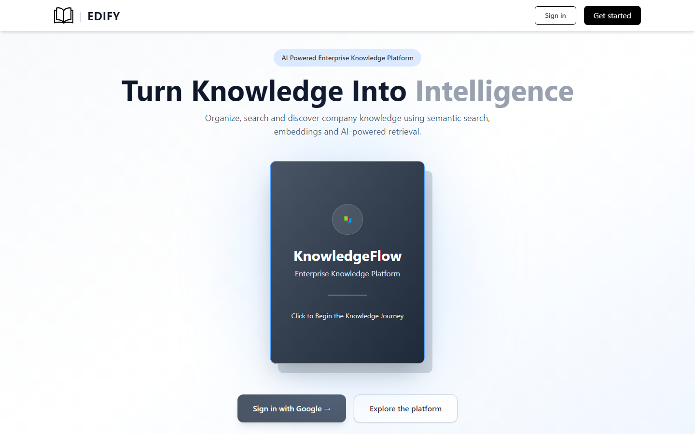

# Edify — RAG Document Ingestor

A small-scale, Rovo-style Retrieval-Augmented Generation platform: upload documents into
Drive-style folders, chunk and embed them locally with Ollama/Qwen, and ask natural
language questions that are answered strictly from the documents your role can see.

Spring Boot is the single HTTP front door (stateful session auth, routing, security);
Vert.x runs *inside the same JVM* and does the actual chunk/embed/persist work off the
event bus, so ingestion is asynchronous without needing a second server or a second auth
layer. The frontend is a React/Vite SPA that is built and served by the same Spring Boot
process in production.



## Table of contents

- [Features](#features)
- [Screenshots](#screenshots)
- [Architecture at a glance](#architecture-at-a-glance)
- [Roles & permissions](#roles--permissions)
- [Project layout](#project-layout)
- [Running it](#running-it)
  - [Option A — Full Docker (production-like)](#option-a--full-docker-production-like)
  - [Option B — Local dev with hot reload](#option-b--local-dev-with-hot-reload)
- [Google OAuth setup](#google-oauth-setup)
- [Configuration reference](#configuration-reference)
- [API examples (curl)](#api-examples-curl)
- [CI/CD](#cicd)
- [Roadmap — making this more like Rovo](#roadmap--making-this-more-like-rovo)
- [Known simplifications](#known-simplifications)

## Features

- **Stateful session auth** with Google OAuth2/OIDC login (`JSESSIONID` cookie, CSRF
  enabled) — no JWTs, no stateless API tokens.
- **Four roles**, enforced both at the HTTP route layer and in SQL: `READ < WRITE <
  CUSTODIAN < ADMIN`. A single hardcoded admin email is auto-provisioned as `ADMIN` on
  first login; everyone else starts as `READ` until promoted.
- **Drive-style document organization** — nested folders, breadcrumbs, per-folder
  minimum-role gating, move documents/folders between locations.
- **Vert.x-powered ingestion pipeline** — chunking, embedding (Ollama `qwen3-embedding`),
  and pgvector persistence run off the main HTTP thread via the event bus.
- **Role-filtered RAG search** — queries are classified for in-scope/out-of-scope intent,
  embedded, matched against pgvector with a role-aware `WHERE`, and answered by an LLM
  (Ollama `qwen3`) using only the retrieved, permitted chunks.
- **One Docker image** for production, a lightweight DB-only Compose file for local dev,
  and a GitHub Actions pipeline that builds/tests/packages on every push.

## Screenshots

| Ask your knowledge base | Documents (Drive-style folders) |
|---|---|
|  |  |

| Access management (ADMIN/CUSTODIAN) |
|---|
|  |

## Architecture at a glance

See [`ARCHITECTURE.md`](ARCHITECTURE.md) for the full write-up. Short version:

```
Browser (React/Vite SPA)
   │ credentialed fetch, CSRF header
   ▼
Spring MVC + Spring Security (session cookie, OAuth2/OIDC login, role routes)
   │
   ├── IngestionController/FolderController ──event bus──▶ IngestionVerticle (Vert.x)
   │                                                           │
   │                                                     ChunkingService
   │                                                     EmbeddingService ──▶ Ollama (qwen3-embedding)
   │                                                           │
   │                                                     Postgres + pgvector
   │
   └── QueryController ──▶ RagOrchestrator ──▶ VectorSearchService (role-filtered cosine search)
                                │                       │
                                └──▶ HttpLlmClient ──▶ Ollama (qwen3 chat)
```

## Roles & permissions

| Role | Can read search results & browse documents | Can upload / update / delete documents & folders | Can grant `WRITE` | Can grant `CUSTODIAN`/`ADMIN` |
|---|:---:|:---:|:---:|:---:|
| `READ` | ✅ | ❌ | ❌ | ❌ |
| `WRITE` | ✅ | ✅ | ❌ | ❌ |
| `CUSTODIAN` | ✅ | ✅ | ✅ | ❌ |
| `ADMIN` | ✅ | ✅ | ✅ | ✅ |

- The single hardcoded admin (`app.security.admin-email`) is seeded in the DB and
  re-asserted as `ADMIN` + `systemAdmin=true` on every login — it cannot be demoted
  through the API.
- Every other new Google sign-in starts at `READ`. An `ADMIN` or `CUSTODIAN` must
  promote them via `PUT /api/admin/users/{id}/role`.

## Project layout

```
src/main/java/com/example/ragingestor/
  config/       Security, CORS
  security/     Role enum, OAuth2/OIDC user services, principal, role-assignment API
  ingestion/    ChunkingService, Vert.x verticle + event-bus gateway, Folder + Document
                controllers/services (module 2)
  rag/          Intent classifier, embeddings client, vector search, LLM client (module 3)
  domain/       JPA entities + repositories, JDBC/pgvector repository

Frontend/       React + Vite + Tailwind SPA (landing page, RAG workspace, Drive-style
                document browser, access management)

docker-compose.dev.yml   DB (+ Adminer) only — run backend/frontend natively for hot reload
docker-compose.prod.yml  Full stack — builds and runs one production image + Postgres
Dockerfile               Multi-stage: Node build → Maven build → JRE runtime
.github/workflows/       CI (build+test+docker) and image-publish pipelines
```

## Running it

You'll need: Docker Desktop, and [Ollama](https://ollama.com) running locally with the
chat and embedding models pulled:

```powershell
ollama pull qwen3:8b
ollama pull qwen3-embedding:0.6b
```

Copy `.env.example` to `.env` and fill in `GOOGLE_CLIENT_ID`, `GOOGLE_CLIENT_SECRET`,
and `APP_ADMIN_EMAIL` (see [Google OAuth setup](#google-oauth-setup) below). `.env` is
git-ignored — never commit real secrets.

### Option A — Full Docker (production-like)

Builds the frontend, backend, and a single runnable image; starts Postgres/pgvector
alongside it. This is the closest thing to how you'd actually deploy it.

```powershell
docker compose -f docker-compose.prod.yml up --build -d
docker compose -f docker-compose.prod.yml logs -f app
```

Open `http://localhost:8080`. The app container reaches your host's Ollama via
`host.docker.internal:11434`. Database data persists in the `postgres_data` volume.
Stop with `docker compose -f docker-compose.prod.yml down` (add `-v` only if you
intentionally want to wipe the database).

### Option B — Local dev with hot reload

Only Postgres (+ an optional [Adminer](https://www.adminer.org/) DB browser at
`http://localhost:8081`) run in Docker; the backend and frontend run natively so you get
fast rebuild/hot-reload loops.

```powershell
docker compose -f docker-compose.dev.yml up -d

# Terminal 1 — backend on :8080
$env:OAUTH_SUCCESS_URL = 'http://localhost:5173/'
mvn spring-boot:run

# Terminal 2 — frontend on :5173 with hot reload
cd Frontend
npm run dev
```

Open the Vite URL printed by `npm run dev` (normally `http://localhost:5173`). The
frontend talks to the backend on `:8080` with `credentials: 'include'`; Spring allows
that origin via `FRONTEND_ORIGIN`. Google OAuth must still use the backend's redirect
URI on port 8080 — the success handler then bounces the browser back to Vite.

Switching between the two is just picking which `-f docker-compose.*.yml` file you pass
to `docker compose`; nothing else in the repo needs to change.

## Google OAuth setup

1. In [Google Cloud Console](https://console.cloud.google.com/apis/credentials), create
   an OAuth 2.0 Client ID of type **Web application**.
2. Authorized JavaScript origins: `http://localhost:8080` (and `http://localhost:5173`
   if you also develop against Vite directly).
3. Authorized redirect URI: `http://localhost:8080/login/oauth2/code/google` — this must
   match **exactly**; Spring Security always redirects back to the backend regardless of
   which frontend origin you're using.
4. If your OAuth consent screen is in "Testing" mode, add your Google account as a test
   user or it will be rejected at the consent screen.
5. Put the generated Client ID/Secret into `.env` as `GOOGLE_CLIENT_ID` /
   `GOOGLE_CLIENT_SECRET`. Never commit them — if a secret was ever pasted into a
   tracked file or shared in chat, rotate it in Cloud Console immediately.

## Configuration reference

All of these have `localhost`-friendly defaults in `application.yml`; override via `.env`
/ compose environment for anything container-specific.

| Variable | Purpose | Default |
|---|---|---|
| `DATABASE_URL` / `_USERNAME` / `_PASSWORD` | Postgres connection | `jdbc:postgresql://localhost:5432/rag_ingestor` |
| `GOOGLE_CLIENT_ID` / `_SECRET` | OAuth2 client | — |
| `APP_ADMIN_EMAIL` | The one hardcoded admin | `admin@example.com` |
| `FRONTEND_ORIGIN` | CORS-allowed SPA origin | `http://localhost:5173` |
| `OAUTH_SUCCESS_URL` | Redirect target after login | `/` |
| `LLM_URL` / `LLM_MODEL` | Ollama chat endpoint/model | `http://localhost:11434/api/chat`, `qwen3:8b` |
| `EMBEDDINGS_URL` / `_MODEL` / `_DIMENSION` | Ollama embeddings endpoint/model/vector size | `http://localhost:11434/api/embeddings`, `qwen3-embedding:0.6b`, `1024` |

## API examples (curl)

After signing in through the browser, copy the `JSESSIONID` cookie value from browser
dev tools, then:

```powershell
$env:JSESSIONID = "paste-your-session-cookie"
$csrf = (curl.exe -s -H "Cookie: JSESSIONID=$env:JSESSIONID" http://localhost:8080/api/csrf | ConvertFrom-Json).token

# Create a folder
curl.exe -X POST http://localhost:8080/api/folders `
  -H "Cookie: JSESSIONID=$env:JSESSIONID" -H "X-CSRF-TOKEN: $csrf" -H "Content-Type: application/json" `
  --data-raw '{"name":"Engineering","parentId":null,"minRoleRequired":"READ"}'

# Upload a document into that folder (swap folderId with the id returned above)
curl.exe -X POST http://localhost:8080/api/documents `
  -H "Cookie: JSESSIONID=$env:JSESSIONID" -H "X-CSRF-TOKEN: $csrf" -H "Content-Type: application/json" `
  --data-raw '{"filename":"handbook.txt","content":"The handbook content goes here.","minRoleRequired":"READ","folderId":"<folder-id>"}'

# Browse a folder's contents (folders + documents + breadcrumbs)
curl.exe -s -H "Cookie: JSESSIONID=$env:JSESSIONID" "http://localhost:8080/api/folders/contents?folderId=<folder-id>"

# Ask a question
curl.exe -X POST http://localhost:8080/api/query `
  -H "Cookie: JSESSIONID=$env:JSESSIONID" -H "X-CSRF-TOKEN: $csrf" -H "Content-Type: application/json" `
  --data-raw '{"question":"What does the handbook say?"}'

# Promote a user to WRITE (CUSTODIAN or ADMIN can do this)
curl.exe -X PUT http://localhost:8080/api/admin/users/<user-id>/role `
  -H "Cookie: JSESSIONID=$env:JSESSIONID" -H "X-CSRF-TOKEN: $csrf" -H "Content-Type: application/json" `
  --data-raw '{"role":"WRITE"}'
```

Other document/folder routes: `PUT /api/documents/{id}` (replace content, re-chunk),
`PUT /api/documents/{id}/move` (`{"folderId": "..."}`), `DELETE /api/documents/{id}`,
`PUT /api/folders/{id}` (rename/re-role), `PUT /api/folders/{id}/move`,
`DELETE /api/folders/{id}` (only when empty).

## CI/CD

- **`.github/workflows/ci.yml`** runs on every push/PR to `main`: `mvn verify` for the
  backend, `npm run lint && npm run build` for the frontend, then a Docker image build
  (no push) as a smoke test that the Dockerfile still produces a runnable image.
- **`.github/workflows/docker-publish.yml`** builds and pushes the production image to
  GitHub Container Registry (`ghcr.io/<owner>/<repo>`) whenever you push a `vX.Y.Z` tag,
  or on manual dispatch. A deploy target can then just `docker pull` that tag instead of
  rebuilding from source.

## Roadmap — making this more like Rovo

Rovo-class assistants combine broad, permission-aware indexing with conversational,
multi-turn retrieval. Rough priority order for closing that gap from here:

1. **Richer file ingestion** — PDF/DOCX/HTML parsing (Apache Tika), OCR for scanned
   docs, and chunking that respects semantic boundaries (headings, tables) instead of a
   fixed word count.
2. **Drive parity features** — drag-and-drop upload, multi-select move/delete, shared
   "starred"/"recent" views, full-text filename search, and trash/restore instead of
   hard-filtering on `DELETED`.
3. **Conversational memory** — today each query is independent; add a conversation/
   session id so follow-up questions ("what about last quarter?") resolve against prior
   turns, not just the new query's embedding.
4. **Hybrid retrieval** — combine pgvector cosine search with keyword/BM25 (e.g.
   Postgres full-text search) and re-ranking, since pure embedding search misses exact
   terms like ticket IDs or product codes.
5. **Per-document/per-folder ACLs beyond one role** — today it's a single
   `min_role_required`; real Rovo-style systems support arbitrary group/user grants.
6. **Source citations with highlights** — return the exact chunk text/offsets used, not
   just document IDs, so users can jump straight to the supporting passage.
7. **Background re-indexing & freshness** — a scheduled job to re-embed updated source
   systems (Confluence/Jira/Drive connectors) rather than only manual upload.
8. **Audit log** — who searched what, who uploaded/deleted what, and role-change
   history, for compliance review.
9. **Observability** — Micrometer/Prometheus metrics on ingestion latency, LLM latency,
   and search relevance; structured logging with request/correlation IDs.
10. **Migrations instead of `schema.sql`** — adopt Flyway/Liquibase so schema changes are
    versioned and reviewable instead of hand-edited idempotent SQL.

## Known simplifications

- `ChunkingService` splits by word count, not actual model token count — fine for a demo,
  not for production chunk-size accuracy.
- Embedding calls happen synchronously inside the ingestion transaction
  (`DocumentIngestionService`); at real volume, split "persist metadata" and
  "embed + persist vectors" into separate steps so a slow embedding call doesn't hold a
  DB transaction open.
- Folder/document ACL is a single `min_role_required` field (coarse). Per-user/per-group
  grants would require a real ACL table.
- No refresh/rotation story for the OAuth2 access/refresh tokens themselves — add
  `spring-security-oauth2-client`'s token services if you need to call the IdP's own
  APIs later, beyond just using it for login.
- `schema.sql` runs on every startup (`spring.sql.init.mode: always`); it's written to be
  idempotent (`create table if not exists`, `add column if not exists`) but a real
  migration tool is recommended before this goes to production.
